# UIII Act6 - Preparacion y evaluacion de imagenes

**Alumno:** Axel Guzman  
**NC:** 0070  
**Docente:** Manuel Nava  
**Asignatura:** Soluciona problemas de Vision Artificial  
**Especialidad:** Inteligencia Artificial  
**Semestre:** Tercer semestre de preparatoria  

## 1 Estructura de carpetas
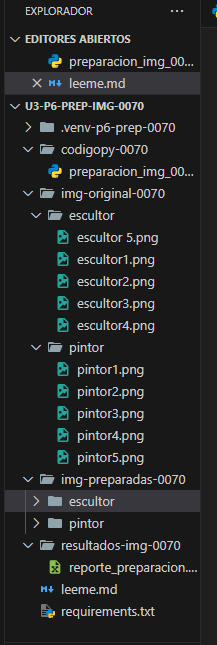

## 2 Imágenes originales 
# escultor

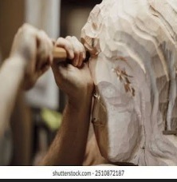
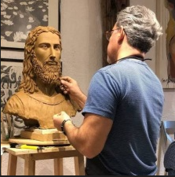
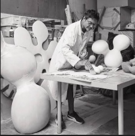
# pintor

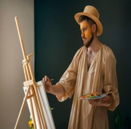
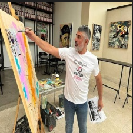
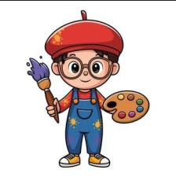

## 3. Código Python
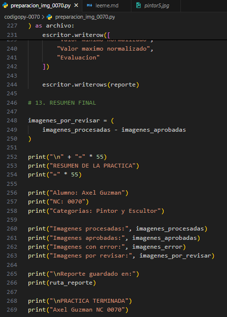

## 4. Ejecución del programa

# pintor
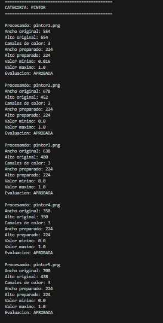
# escultor
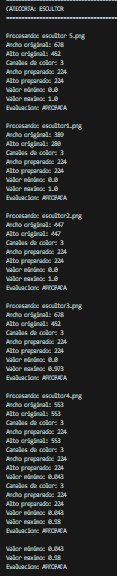

## 5.Imágenes preparadas
# escultor

# pintor

## 6. Resultados
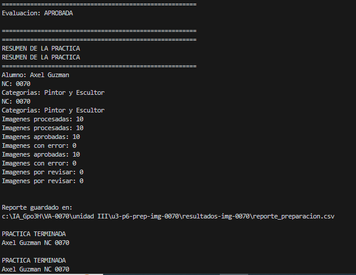

**Axel Guzman NC 0070**
